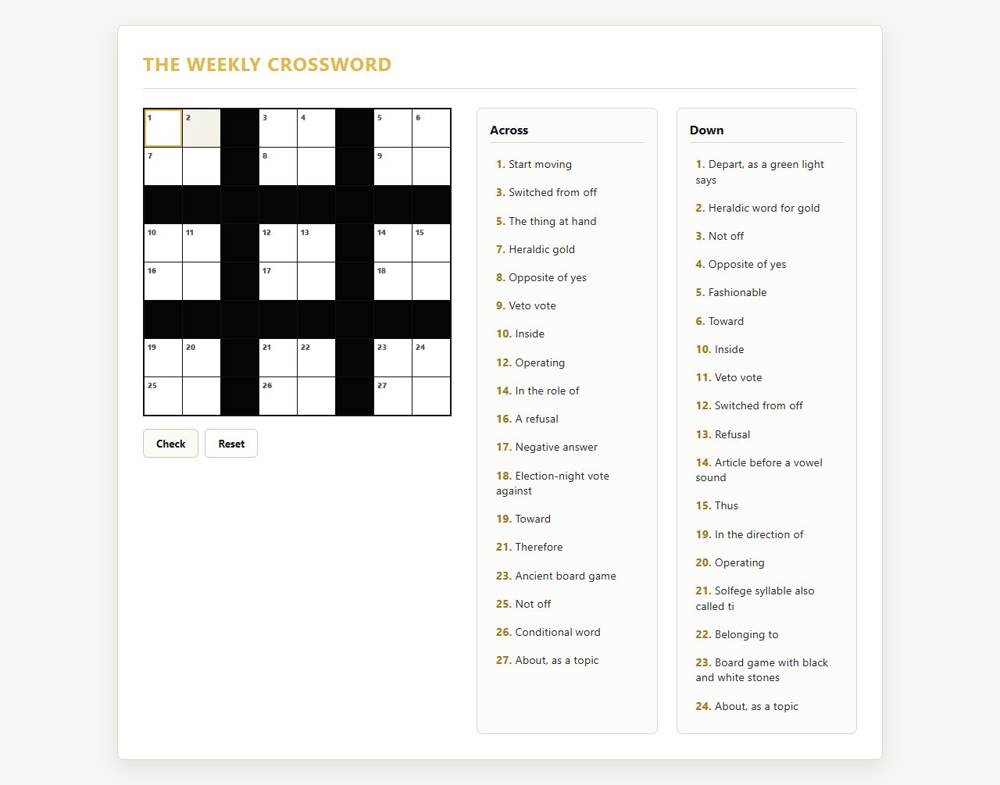
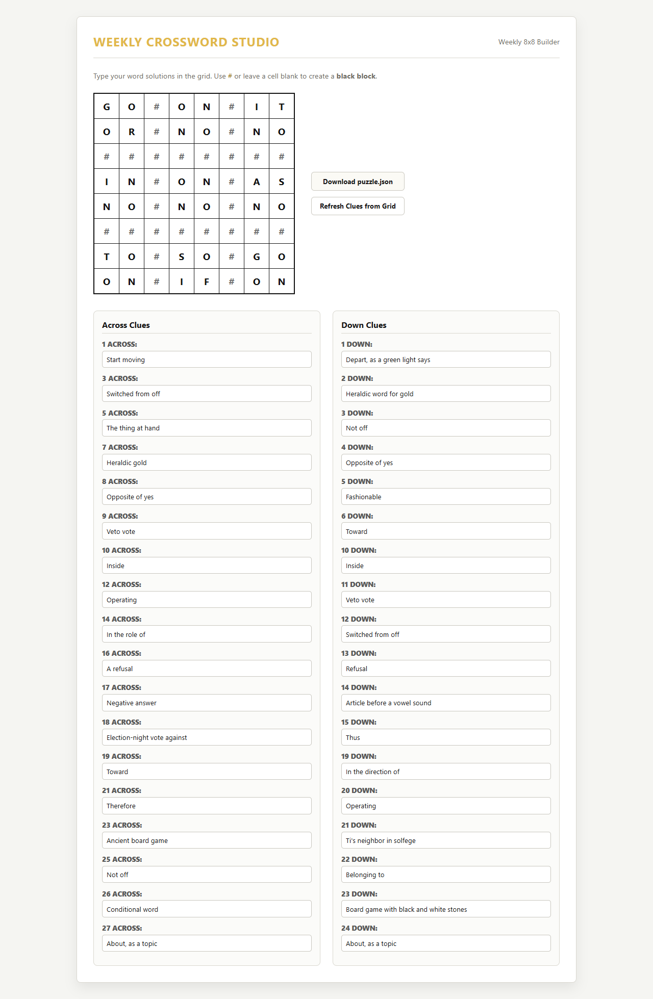

# The Weekly Crossword

A browser-based crossword game with a companion puzzle editor. Solve an 8×8 crossword, or build your own grid and export it as a JSON file to share with players.

Built with **HTML, CSS, and vanilla JavaScript**—no backend or build step required.



## Features

### Crossword player

- Numbered grid with Across and Down clues.
- Keyboard input and arrow-key navigation.
- Highlighting for the selected word and cell.
- Answer checking and a reset button.
- Puzzle content loaded from a replaceable JSON file.

### Puzzle studio

- Editable 8×8 solution grid.
- Blank cells or `#` markers for black squares.
- Automatic numbering and clue-field generation.
- Downloadable `puzzle.json` for publishing a new puzzle.

<details>
<summary>View the puzzle studio</summary>



</details>

## Run locally

You need Git, Python 3, and a modern browser.

```bash
git clone https://github.com/SambhavPyakurel/Crosswords.git
cd Crosswords
```

Start a local server:

```powershell
# Windows
py -3 -m http.server 8000 --bind 127.0.0.1
```

```bash
# macOS / Linux
python3 -m http.server 8000 --bind 127.0.0.1
```

Open the **[player](http://localhost:8000)** or **[puzzle studio](http://localhost:8000/admin.html)**. Keep the terminal open while playing; press `Ctrl+C` to stop.

Serve the files over HTTP rather than opening `index.html` directly, so the browser can fetch `puzzle.json`.

## How to play

| Control | Action |
| --- | --- |
| Click a cell | Select it |
| Click the selected cell again | Switch between Across and Down |
| Type a letter | Fill the cell and advance in the selected direction |
| Arrow keys | Move to an adjacent playable cell |
| Backspace | Clear a letter, or move backward if the cell is empty |
| Check | Compare your entries with the solution |
| Reset | Clear the board |

Movement stops at blocks and grid edges. Progress is kept in memory and resets when the page reloads.

## Make your own puzzle

1. Open `admin.html` to start from the studio's sample puzzle.
2. Enter solution letters. Leave cells blank or type `#` to create blocks.
3. Click **Refresh Clues from Grid** after changing the layout.
4. Fill in and review the Across and Down clues. Layout changes can renumber answers, so check existing clue text carefully.
5. Click **Download puzzle.json**.
6. Replace the project's root `puzzle.json` with the downloaded file, then refresh the player. Publish the changed file to update a hosted game.

The studio starts from the sample in `admin.js`; it does not import the player's current JSON. Downloads are saved locally and do not automatically update a hosted site.

## Project structure

```text
Crosswords/
├── index.html       # Player page
├── player.js        # Grid rendering, navigation, and answer checking
├── admin.html       # Puzzle studio
├── admin.js         # Grid editing, clue numbering, and JSON export
├── puzzle.json      # Published puzzle and solution
├── style.css        # Shared styling
└── docs/images/     # Screenshots
```

## Puzzle format and scope

`puzzle.json` contains a grid `size`, a square `solution` array, and `clues.across` / `clues.down` objects keyed by clue number. Use `#` for blocked cells.

This is a static application: solutions are included in the public JSON, and the studio is not an authenticated admin portal. New puzzles are published manually; there is no automatic weekly rotation or saved player progress.
